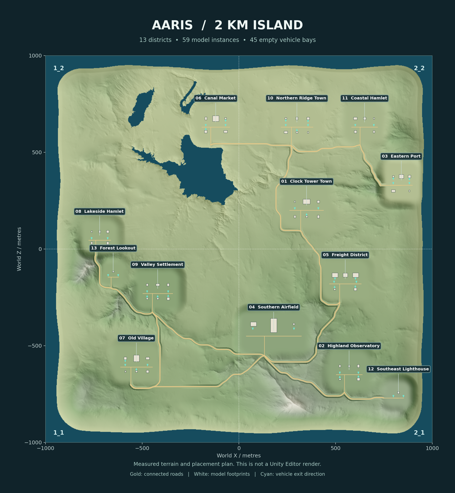

# Aaris Island — 2 km × 2 km Unity URP environment

A saved, native Unity scene covering **4,000,000 m²**, assembled from the original
four central vendor Terrain tiles **1_1, 1_2, 2_1, 2_2**. The other twelve full
Terrain tiles and obsolete proxy Terrain assets are removed from the current
checkout. Their earlier versions remain in Git history.

Open **`Assets/TerrainDemoScene_URP/Scenes/TerrainDemoScene.unity`** in
**Unity 6000.3.26f1**, with **URP 17.3**. No map builder, pre-export menu action,
glTF importer or runtime generation script is required. Native scene objects,
TerrainData, Mesh assets, materials, static colliders and empty spawn points are
already saved. Package Manager restores the declared URP/VFX dependencies.

Clone with **Git LFS** and run `git lfs pull`. GitHub ZIP source downloads may
contain LFS pointers instead of the original meshes and textures.

## Layout

Thirteen districts include Clock Tower Town, Highland Observatory, Eastern Port,
Southern Airfield, Freight District, Canal Market, Old Village, Lakeside Hamlet,
Valley Settlement, Northern Ridge Town, Coastal Hamlet, Southeast Lighthouse
and Forest Lookout. They contain 59 placed instances of 17 unique model sources.
The original seven supplied GLBs included one duplicate, so six unique sources
were combined with the eleven additional buildings.

The original interior landform and surviving trees, rocks, grass and terrain
textures are retained outside edited footprints. A shared, quantized height grid
keeps all four tile seams identical. A rounded coastal falloff sinks every outer
Terrain edge below the ocean, including all four corners. The ocean is a native
URP water surface with subtle animated waves. There are no additional terrain
skirts pretending to be playable map area.

Connected district streets and a 240 m small-aircraft runway are saved as native
meshes over graded Terrain. Foundations are level, buildings use their actual
static mesh colliders, glTF PBR textures are converted for URP Lit, and source
vehicle/character/weapon nodes from the starter scenes are excluded. Some source
buildings are exterior shells or have authored closed doors; interiors and all
entrances still need an Editor/playtest review.

## Vehicle phase

`Aaris_Island_2km/VehicleSpawns` contains **45 empty GameObjects** named
`VehicleSpawnPoint_01`, etc. No drivable vehicle models or physics scripts are
added. Each marker is at the Terrain contact surface, with local **+Z** facing a
clear exit to the connecting street. Full 6 m × 12 m bays and exit corridors are
reserved outside building bounds and cleared of terrain trees/rocks/shrubs.

Later vehicle prefabs must use an appropriate wheel/contact offset from this
**ground anchor**; a chassis-centred prefab pivot should not be placed directly
at marker y without that offset.

## Verification and editable map data

- [`Docs/MAP_LAYOUT.json`](Docs/MAP_LAYOUT.json): world coordinates, all districts,
  model placements, roads, vehicle bays, source URLs/hashes and tile removals.
- [`Docs/MAP_BUILD_REPORT.json`](Docs/MAP_BUILD_REPORT.json): exact tile dimensions,
  seam comparison, shoreline, foundation, spawn and road-grade assertions.
- [`Docs/TERRAIN_INDEX.json`](Docs/TERRAIN_INDEX.json): searchable per-tile tree,
  rock and shrub coordinates, sampled height CSVs and grass-density patches.
- [`Docs/MAP_STRUCTURE_REPORT.json`](Docs/MAP_STRUCTURE_REPORT.json): native Mesh
  buffers, scene references and asset GUID checks.
- [`Tools/MapBuild/`](Tools/MapBuild/): deterministic, build-time-only assembly
  source, pinned model provenance and reproduction instructions.

**Validation here is offline. Unity Editor import, shader compilation, visual
inspection, lighting, physics simulation, navigation and a target-device build
have not been performed.** The reports explicitly mark these as untested.
Current building LODs provide distance culling; lower-poly LOD meshes, lighting
bakes and device-specific performance tuning remain separate work. Water has no
swimming, damage or map-boundary gameplay. This is environment source, not a
complete battle-royale game.

## Source and licensing

The original Unity Terrain URP vendor assets remain private and require the
appropriate Unity Asset Store licence. See `URP-TERRAIN-PROVENANCE.md`. Newly
included building sources and their CC0 provenance are recorded individually in
`Tools/MapBuild/model_sources.json` and the layout report. Keep the repository
private; the new model licences do not change the vendor terrain licence.

`TRANSFER-MANIFEST.json` and `TRANSFER-VERIFIED.json` are **historical records of
the original vendor import**, not checksums of this edited island. Current edited
Terrain checksums are recorded in `Docs/MAP_BUILD_REPORT.json`.
